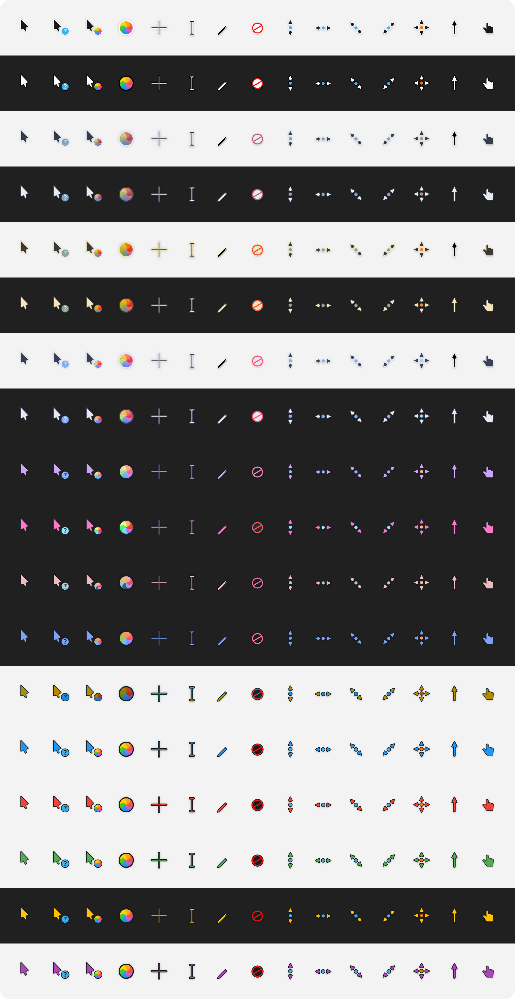

<div align="center">

# Capitaine Cursors for Windows

**macOS-inspired Capitaine cursors for Windows 11, rendered from the original vector artwork at every size Windows
picks for your display scale and pointer size. Dark and Light, plus 16 palette and colour variants.**

[](https://github.com/hervad/capitaine-cursors-w11-hidpi/releases/latest)
[](#install)
[](COPYING)



</div>

## Install

1. **Download** the zip for your variant from the [latest release](https://github.com/hervad/capitaine-cursors-w11-hidpi/releases/latest)
   and extract it.
2. **Right-click** `install.inf` in the extracted folder and choose **Install**, then approve the administrator prompt.
   On Windows 11, **Install** is under **Show more options**.
3. **Apply:** Mouse Properties may open by itself; if it doesn't, press <kbd>Win</kbd>+<kbd>R</kbd> and run `main.cpl`.
   On the **Pointers** tab, pick the scheme and click **OK**.

**Upgrading from 3.0, 2.0 or 1.0?** Since 3.1 the schemes are called *Capitaine Dark/Light W11 HiDPI*; remove the
old ones so they don't stay in the list - the
[installation guide](INSTALL.md#upgrading) has the commands.

## Pick a variant

Each variant is its own zip, `capitaine-<variant>-w11-hidpi-v….zip`, and its own scheme,
*Capitaine &lt;Name&gt; W11 HiDPI*. The preview above shows them in this order, top to bottom;
[this labelled sheet](docs/variants.png) shows each one on a dark and a light background.

| Variant | Zip `<variant>` | Look |
| --- | --- | --- |
| **Dark** | `dark` | Black pointer, white outline (the original) |
| **Light** | `light` | White pointer, black outline (the original) |
| **Nord Dark** / **Light** | `nord-dark` / `nord-light` | [Nord](https://www.nordtheme.com) colours |
| **Gruvbox Dark** / **Light** | `gruvbox-dark` / `gruvbox-light` | [Gruvbox](https://github.com/morhetz/gruvbox) colours |
| **Palenight Dark** / **Light** | `palenight-dark` / `palenight-light` | Material Palenight colours |
| **Catppuccin Mocha** | `catppuccin-mocha` | Mauve pointer, Mocha outline and accents |
| **Dracula** | `dracula` | Pink pointer, Dracula outline and accents |
| **Rose Pine** | `rose-pine` | Rose pointer, Rosé Pine outline and accents |
| **Tokyo Night** | `tokyo-night` | Blue pointer, Tokyo Night outline and accents |
| **Solarized** | `solarized` | Yellow pointer, Solarized outline and accents |
| **Blue**, **Red**, **Green**, **Amber**, **Purple** | `blue`, `red`, `green`, `amber`, `purple` | Coloured pointer, dark outline, original spinner |

- **Nord, Gruvbox and Palenight** use the colours of
  [sainnhe's Capitaine fork](https://github.com/sainnhe/capitaine-cursors) (release r5), outline included.
- **Catppuccin, Dracula, Rosé Pine, Tokyo Night and Solarized** colour the whole pointer with one signature colour
  of the palette, so each looks different from the others and from Dark.
- Every variant is outlined, so it stays visible on any background. Install as many as you like and switch in
  `main.cpl`.

## Sharp at every display scale and pointer size

Windows doesn't resize a cursor smoothly. It looks in the file for an image of one exact size, and if that size is
missing it resamples the nearest image, which blurs. The size it wants is your **pointer size** (**Settings ›
Accessibility › Mouse pointer and touch**: size 1 = 32 px, +16 px per step) **× a factor for your display scale**.
Every cursor here contains each of those sizes, rendered from the vector artwork:

| Display scale | Factor | Size 1 | 2 | 3 | 4 | 5 |
| --- | :-: | :-: | :-: | :-: | :-: | :-: |
| 100–149 % | 1.0, measured | 32 | 48 | 64 | 80 | 96 |
| 150–199 % | 1.5, measured | 48 | 72 | 96 | 120 | 144 |
| 200–249 % | 2.0, assumed | 64 | 96 | 128 | 160 | 192 |
| 250–299 % | 2.5, assumed | 80 | 120 | 160 | 200 | 240 |
| 300 %+ | 3.0, assumed | 96 | 144 | 192 | 240 | 256 |

Sizes in pixels; 256 is Windows' maximum. The factors were measured on Windows 11 25H2; the assumed ones continue
the pattern.

- **Static cursors** contain every size in the table.
- **Busy and working** (animated) contain every size in the two measured rows, plus 128, 192 and 256 px. Elsewhere
  Windows resizes the nearest one.
- **At 125 % and 175 %** some softness comes from Windows itself: it takes the 100 % or 150 % image and stretches it.

**No performance cost.** Windows decodes a cursor once, when you change scheme or size. Compared with Microsoft's
own `aero` cursors on Windows 11 25H2, a static cursor loads in 0.2–0.3 ms (aero 0.1–0.2), an animated one in
3–5 ms at 32–96 px (aero 1–4) and 15 ms at 256 px (aero 20), and 300 loads leave no handles behind. Before every
release, GitHub Actions loads every file with the real Windows cursor loader; any failure blocks the release.

## What's included

- **All 17 Windows pointer roles:** normal, help, working in background, busy, precision, text, handwriting,
  unavailable, 4 resize directions, move, alternate, link, location and person select. Location and person select use
  the pointing hand (Capitaine has no artwork for them; before 3.0 they were left empty).
- **Animated busy and working cursors:** 24 frames at 30 fps, as in the original.
- **Hotspots** on the tip or centre at every size; the pen's is on the pencil tip.
- `install.inf` and `uninstall.cmd` for each variant, plus the licence and attribution.

## Uninstall

1. Run `uninstall.cmd` from the extracted folder. It removes the scheme from the list and opens Mouse Properties.
2. Pick another scheme and click **OK**.
3. Delete the cursor files from an administrator PowerShell, for example:

```powershell
Remove-Item "C:\Windows\Cursors\Capitaine Dark W11 HiDPI" -Recurse
```

## Build from source

Since 3.0 the cursors are built with [w11-cursor-toolkit](https://github.com/hervad/w11-cursor-toolkit) from the
original repository, pinned as a git submodule in `upstream/` at
[commit 06c8843](https://github.com/keeferrourke/capitaine-cursors/tree/06c88433662a4004cf56a6e471b523a0a8880be0).
Rendering uses resvg, which the toolkit installs.

```powershell
git clone --recurse-submodules https://github.com/hervad/capitaine-cursors-w11-hidpi
cd capitaine-cursors-w11-hidpi
python -m pip install "w11cursor @ git+https://github.com/hervad/w11-cursor-toolkit@v0.4.0"
w11cursor build    theme.toml --out dist
w11cursor validate theme.toml --dist dist
```

Releases are built by GitHub Actions from a version tag. [TECHNICAL.md](TECHNICAL.md) explains the sizes, hotspots
and animation limits.

## Credits

The artwork is [Capitaine Cursors](https://github.com/keeferrourke/capitaine-cursors) by
[Keefer Rourke](https://krourke.org) and contributors, based on [KDE Breeze](https://invent.kde.org/plasma/breeze).
The Nord, Gruvbox and Palenight colours are by [sainnhe](https://github.com/sainnhe/capitaine-cursors); the other
palettes belong to their projects. This project packages it all for Windows. See [CREDITS.md](CREDITS.md).

Licensed under the [GNU LGPL v3.0 or later](COPYING).
